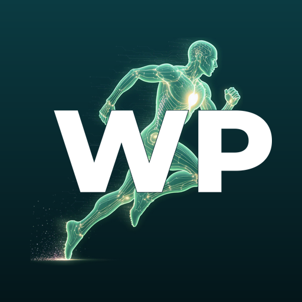

# Wellness Project

Connect your health and fitness data to Claude with Wellness Project. Analyze workouts, nutrition, sleep, recovery, activity and body metrics across your connected devices and manual logs. Track progress toward your goals, explore trends and log meals or workouts through conversation.

## What you can do

- Review training history, exercise progression and workout volume.
- Explore sleep, recovery, heart rate, activity and body composition trends.
- Review nutrition, calories, macros and hydration.
- Log meals, workouts and other supported records when you ask Claude to do so.
- Explore your goals and wellbeing using your existing records.

Connect supported sources such as Apple Health, Google Health Connect, Fitbit, Garmin, Oura, WHOOP, Withings, Hevy and other integrations, subject to source availability and account eligibility. Manual logging is also available without a wearable.

## Getting started

1. Create or sign in to your account at [Wellness Project](https://wellnessproject.ai).
2. In Wellness Project, connect your preferred data sources under Settings > Devices, or log data manually.
3. Install this plugin in Claude and authorize the Wellness Project connector when prompted.
4. Ask a question or request a log entry. In Claude Code, use the MCP connection menu to authenticate if needed.

No local server, software installation, API key or client secret is required. The plugin uses the hosted HTTPS MCP server at https://wellnessproject.ai/api/mcp with OAuth authorization.

## Example prompts

- How did my training look this week?
- Show my sleep trends over the last month.
- How has my resting heart rate changed?
- Log today's lunch: a chicken burrito bowl.
- How am I progressing toward my goals?

## Privacy and permissions

This plugin transmits authorized requests to the Wellness Project hosted MCP server and returns account data to Claude to fulfill your requests. Depending on what you ask, this can include health, fitness, nutrition, sleep, recovery and other personal records. The remote server authenticates requests using OAuth and scopes access to the signed-in user's account. Write tools can create, update or delete supported records when requested. Review the authorization and applicable AI processing disclosures before connecting. You can revoke connector access in your Wellness Project account settings.

The plugin itself contains configuration, an optional setup skill and documentation; it runs no local scripts or background jobs. Wellness Project is informational software, not a medical device or a substitute for professional medical advice.

## Pricing and support

Wellness Project offers a free Basic plan and optional paid Pro features. Availability, usage limits and prices depend on your account and platform; see the app for current terms.

- [Claude integration and documentation](https://wellnessproject.ai/integrations/claude)
- [Support](https://wellnessproject.ai/support) or support@wellnessproject.ai
- [Privacy policy](https://wellnessproject.ai/privacy)
- [Terms of service](https://wellnessproject.ai/terms)
- [Full tool catalog and source repository](https://github.com/turnnoblindeye/wellness-project-mcp/tree/main)

Published by Wellness Project LLC. See LICENSE and NOTICE for licensing details.
